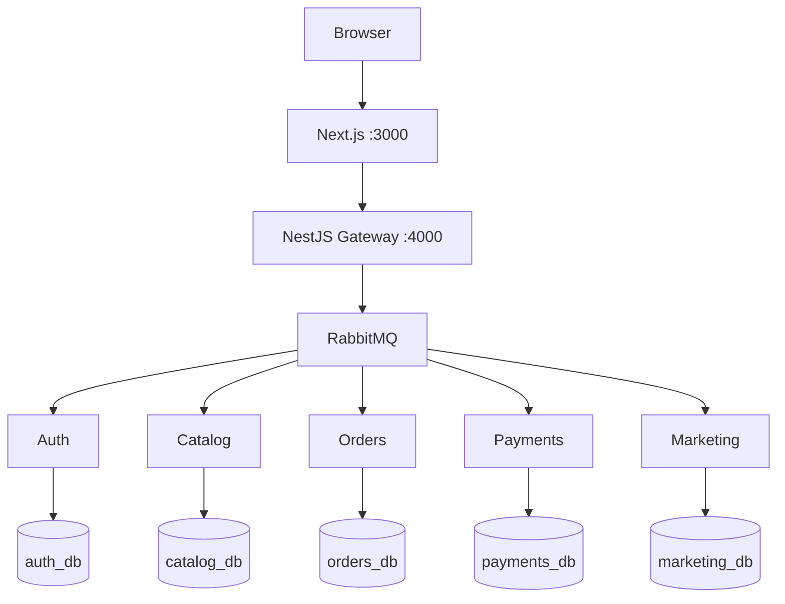

# Target deployment

This is the target topology. Auth/catalog/orders HTTP/RMQ and checkout event edges are active through stage 4. Payments and marketing business consumers remain later milestones.
