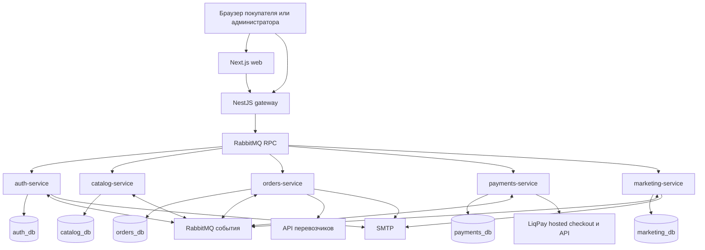
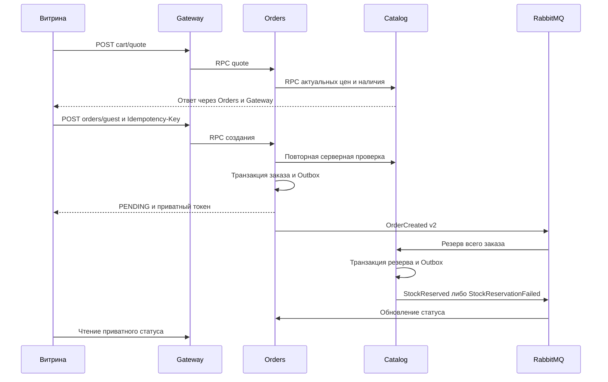

# Чайний Елемент

Документация разработчика на русском языке. Срез реализации от 19 ноября 2026 года, исходный коммит `e057d3e`. Адресована владельцу проекта и разработчику, который впервые читает код. Здесь разобраны архитектура, выбор технологий, сервисы, согласованность данных и путь заказа. Платежи объяснены с нуля в отдельной главе.

## Содержание

1. [Архитектура и путеводитель по коду](#архитектура).
2. [Базы данных, ER-диаграммы и словарь всех полей](database.md).
3. [Платежная система и LiqPay](payments.md).
4. [Запуск, безопасность и эксплуатация](operations.md).
5. [Подготовка к собеседованию](interview.md).

Схемы Mermaid отображаются в GitHub и редакторах с поддержкой Mermaid. Ссылки на файлы открывают реализацию в этом репозитории.

## Состояние реализации

Работают каталог чая и посуды, фильтрация, поиск, корзина, гостевой checkout, покупка сразу, аккаунты, административные операции, резервы и склад, очереди писем и упрощенные рассылки. Описание чая вынесено в отдельный раздел. Для Новой почты реализованы подсказки городов и отделений/почтоматов и расчет доставки. Для Укрпочты покупатель вручную вводит город и номер отделения, стоимость перевозки оплачивается отдельно.

В orders-service предусмотрено письмо владельцу по `ORDER_OWNER_EMAIL`. Локально адрес настроен в игнорируемом `.env`; секреты и персональные настройки в эту документацию не включены. Доставка через реальный SMTP в Gmail ещё требует приемки. LiqPay реализован для sandbox, конфигурация и конструктор адаптера отклоняют live-ключи. Публичный production-деплой и реальное зачисление денег не подтверждены.

Убрана верхняя плашка о демонстрационном магазине, но в оформлении и оплате сохраняется тестовый текст. Удаление плашки само по себе не переключает платежи или данные в рабочий режим. Часть ранних этапов в SPEC, AGENTS и README описывает историю разработки; текущее поведение следует сверять с кодом и этой документацией.

## Архитектура

Это монорепозиторий с семью приложениями. Пять доменных сервисов и gateway образуют бэкенд. `apps/web` — клиентский интерфейс и серверный рендеринг страниц Next.js. Поэтому папки `server` и `client` отсутствуют. Их роль выполняют приложения в `apps`.

| Приложение        | Порт по умолчанию                   | Ответственность                                                    |
| ----------------- | ----------------------------------- | ------------------------------------------------------------------ |
| web               | 3000, в нашей локальной сессии 3001 | Витрина, аккаунт, административный интерфейс                       |
| gateway           | 4000                                | HTTP API, cookies, guards, валидация и перенаправление RPC         |
| auth-service      | 4001                                | Пользователи, пароли, сессии, подтверждение email                  |
| catalog-service   | 4002                                | Товары, цены, скидки, медиа, физические остатки и резервы          |
| orders-service    | 4003                                | Корзины аккаунтов, снимки заказов, fulfillment и письма по заказам |
| payments-service  | 4004                                | Попытки оплаты, подписи, webhook, сверка и компенсации             |
| marketing-service | 4005                                | Согласия, история покупок, два вида рассылок и журнал доставки     |

HTTP-порты доменных сервисов используются для health/docs. Бизнес-запросы внешнего клиента проходят через gateway. Каждая БД принадлежит одному сервису. В локальном Docker Compose пять БД размещены в одном экземпляре PostgreSQL, что сохраняет логическое разделение и сокращает стоимость окружения.

### Карта репозитория

- `apps` содержит запускаемые приложения.
- `packages/contracts/src` содержит DTO, типы RPC и версионированные события.
- `packages` также содержит общие конфигурации TypeScript и ESLint.
- `infra` содержит Docker Compose и инициализацию ролей PostgreSQL.
- `scripts` содержит setup, health, интеграционные тесты и платежное демо.
- `docs/adr` хранит решения с причинами и компромиссами.

Внутри доменного модуля используется направление зависимостей `presentation → application → domain`, а `infrastructure` реализует порты из `domain`.

| Слой           | Пример                                 | Зачем нужен                                  |
| -------------- | -------------------------------------- | -------------------------------------------- |
| presentation   | RPC-контроллер, HTTP DTO               | Принимает запрос и проверяет внешние данные  |
| application    | `CreateOrder`                          | Оркестрирует конкретную операцию             |
| domain         | `OrderStore`, `validateOrderQuote`     | Формулирует правила и необходимые интерфейсы |
| infrastructure | `PrismaOrderStore`, `RmqQuoteProvider` | Реализует хранение и внешнее взаимодействие  |

Пример границы — [CreateOrder](../../apps/orders-service/src/modules/orders/application/create-order.ts). Он зависит от `OrderStore` и `QuoteProvider`, а конкретный Prisma-класс подставляется Nest DI. Доменные правила можно тестировать без поднятой БД. Модули с минимальной логикой могут иметь меньше слоев.

## Почему выбраны эти технологии

| Технология            | Роль и причина выбора                                            | Стоимость решения и альтернатива                                                                                 |
| --------------------- | ---------------------------------------------------------------- | ---------------------------------------------------------------------------------------------------------------- |
| TypeScript            | Общие типы для UI, RPC и событий                                 | Типы исчезают в runtime, поэтому остаются Zod и class-validator                                                  |
| Next.js App Router    | Рендеринг каталога, SEO, маршруты и интерактивные формы          | Серверные и клиентские границы нужно учитывать; SPA упростила бы рендеринг, но потребовала другого подхода к SEO |
| React Hook Form и Zod | Состояние формы и проверка входных значений                      | Клиентская проверка дублируется на серверной границе                                                             |
| TanStack Query        | Загрузка, повторное чтение и кэш серверного состояния в браузере | Нельзя считать кэш подтверждением наличия или оплаты                                                             |
| Zustand persist       | Корзина гостя между перезагрузками                               | Браузерное хранилище недоверенное; сервер пересчитывает цены                                                     |
| NestJS                | DI, модули, guards и RabbitMQ transport                          | Для небольшого API Express/Fastify требуют меньше инфраструктуры                                                 |
| PostgreSQL            | Транзакции, ограничения, индексы, блокировки и JSONB-снимки      | Нужны миграции, обслуживание и резервное копирование                                                             |
| Prisma                | Типизированный клиент и миграции отдельно для каждого сервиса    | Для locks и сложных отчетов используется параметризованный SQL                                                   |
| RabbitMQ              | RPC и асинхронные события, подтверждения и очереди повторов      | Дополнительный процесс и eventual consistency; HTTP проще для изолированного запроса                             |
| Redis                 | Предусмотрен локальной инфраструктурой                           | Серверный кэш каталога и общий rate limit через Redis пока не реализованы                                        |
| Docker Compose        | Воспроизводимое локальное окружение                              | Не предоставляет автоматическое масштабирование и отказоустойчивость кластера                                    |
| Jest и Supertest      | Проверка правил, границ HTTP и интеграционных сценариев          | Успех тестов не измеряет допустимую production-нагрузку                                                          |
| Mailpit               | Локальный прием SMTP и просмотр писем                            | Для доставки покупателям нужен рабочий SMTP-провайдер                                                            |

Для одного магазина с небольшим трафиком модульный монолит обычно дешевле в эксплуатации. Здесь микросервисы дают практику автономного владения данными, событий и платежной согласованности. Цена — семь процессов, пять БД, брокер, больше сценариев отказа и сложнее диагностика. Эти границы имеют смысл объяснять через ответственность сервисов, а производительность подтверждать отдельными измерениями.

## HTTP, RPC и события

HTTP-запрос браузера к `/api/v1/...` приходит в gateway. Gateway выполняет аутентификацию, проверяет Origin для изменяющих запросов, DTO и роль, затем отправляет RPC-сообщение с correlation ID. RPC ожидает ответ конкретного сервиса; некоторые клиенты ограничивают ожидание восемью секундами. Timeout означает неопределенность для вызывающего кода: операция могла успеть завершиться.

Событие фиксирует уже произошедший факт. `OrderCreated` не ожидает завершения резервирования перед HTTP-ответом. UI получает `PENDING` и затем читает актуальный статус. Корреляция связывает запросы и события в диагностике.

Контракты лежат в [packages/contracts](../../packages/contracts/src/index.ts), очереди и payload перечислены в [каталоге событий](../architecture/events.md). Его ранние абзацы содержат исторические пометки о планируемом marketing consumer; фактические обработчики маркетинга уже реализованы.

## Паттерны и отказоустойчивость

### Gateway и Database per Service

Gateway предоставляет единый вход и правила доступа. Цена — дополнительный hop и общий компонент, который должен быть доступен. Он не владеет бизнес-БД. Данные пользователя, заказа и платежа принадлежат разным сервисам; ссылки по UUID между ними логические. Внешний ключ `orders.userId → auth.users.id` через две БД не создается. Данные получают через RPC или событийную проекцию.

### Transactional Outbox

В [PrismaOrderStore.create](../../apps/orders-service/src/modules/orders/infrastructure/prisma-order-store.ts) заказ и `Outbox` сохраняются одной транзакцией. Если вставка события не проходит, заказ откатывается. Отдельный [OutboxPublisher](../../apps/orders-service/src/shared/outbox/outbox-publisher.ts) выбирает запись через `FOR UPDATE SKIP LOCKED`, публикует с publisher confirms и отмечает `publishedAt`.

Если RabbitMQ недоступен, запись остается в БД. Задержка следующей попытки растет до пяти минут. Если процесс упал после подтверждения брокера, но до коммита `publishedAt`, событие будет отправлено повторно. Поэтому получатели обязаны быть идемпотентными. В текущей реализации сетевое ожидание publish находится внутри транзакции Outbox — это удерживает соединение БД и ограничивает throughput.

### Идемпотентность

На HTTP-границе используется UUID `Idempotency-Key`. Заказ хранит hash ключа с контекстом гостя или пользователя и hash содержимого запроса. Повтор с теми же данными возвращает уже созданный заказ. Тот же ключ с другими данными вызывает конфликт. Это помогает при двойном клике и потерянном ответе.

На событийной границе `processed_events.eventId` фиксируется в той же транзакции, что и бизнес-изменение. Дополнительно операции защищены по order ID, резервам, attempt ID и уникальным command keys. Это покрывает семантический повтор, когда одно действие пришло с разными event ID. Доставка сообщений допускает повторы; бизнес-эффект должен применяться один раз.

### Saga и компенсации

Глобальной транзакции между orders, catalog и payments нет. Они делают локальные транзакции и обмениваются фактами. Резерв освобождается событием отмены. Запоздалая оплата отмененного заказа инициирует платежную компенсацию. Такой workflow представляет собой событийную saga с компенсациями. Центрального универсального saga-engine здесь нет, переходы распределены по конкретным обработчикам.

Если отмена пришла раньше создания, catalog сохраняет tombstone резерва, а payments — запись отмененного заказа. Позднее сообщение не должно снова зарезервировать или оставить деньги без обработки.

### Strategy и Anti-Corruption Layer

[PaymentProvider](../../apps/payments-service/src/modules/payments/domain/payment-provider.ts) определяет общий интерфейс для Fake и LiqPay. Выбор адаптера делает [PaymentProvidersModule](../../apps/payments-service/src/modules/payments/payment-providers.module.ts). Это применение Strategy через DI и ports/adapters.

LiqPay-адаптер переводит формат провайдера в собственные `PaymentObservation` и статусы, проверяет сумму, валюту и идентификатор. Остальные сервисы не зависят от всех полей внешнего webhook. Так работает Anti-Corruption Layer. Аналогичный перевод справочников есть у почтового адаптера.

### Проекции и разделение чтения и записи

orders хранит `VerifiedIdentity`, чтобы связывать старые гостевые заказы после подтверждения email. marketing хранит собственную проекцию клиентов и завершенных покупок. Чтение админки отделено в специализированные use cases и SQL-запросы. Это элементы CQRS и read models; проект не строит всю историю сущностей из event store. Outbox служит доставке и не заменяет текущее состояние в таблицах.

## Конкурентные запросы

| Место               | Механизм                                                | Какую гонку предотвращает                                              |
| ------------------- | ------------------------------------------------------- | ---------------------------------------------------------------------- |
| Создание заказа     | Advisory lock по hash idempotency key и уникальный hash | Два заказа от одинакового повторного запроса                           |
| Операции заказа     | Advisory lock по order ID и повторное чтение            | Одновременная отмена, отгрузка и платежное событие                     |
| Остатки             | Блокировка inventory и общий порядок product ID         | Перепродажа последнего остатка и взаимные блокировки смешанной корзины |
| Refresh token       | `FOR UPDATE OF users`                                   | Одновременная ротация и отзыв семейства сессий                         |
| SMTP и Outbox       | Lease/`SKIP LOCKED` в соответствующих workers           | Одновременная обработка одной записи несколькими процессами            |
| Админские изменения | Revision и журнал команды                               | Перезапись устаревшей формы и повтор операции                          |
| Отчеты              | `RepeatableRead` в выбранных репозиториях               | Разные версии данных для списка, счетчика и итогов одного ответа       |

`RepeatableRead` применяется явно в местах чтения; общего `Serializable` для всех операций нет. Локальная транзакция обеспечивает согласованность одной БД. Согласованность между БД достигается позже, когда обработаны события.

## Кэширование

| Уровень                  | Ключ и время                                                                   | Обновление и ограничения                                                                |
| ------------------------ | ------------------------------------------------------------------------------ | --------------------------------------------------------------------------------------- |
| React `cache` на сервере | `getProduct(slug)`, `getCategories()`                                          | Дедупликация вызовов в контексте серверного рендера; постоянный TTL не задан            |
| Fetch каталога           | URL, `cache: no-store`                                                         | Новый запрос к gateway вместо постоянного Next Data Cache                               |
| TanStack Query           | `cart-quote` + items; delivery keys включают selection, payment method и items | Общий `staleTime` 30 секунд; сумма корзины перечитывается каждые 30 секунд и при фокусе |
| Корзина Zustand          | `tea-guest-cart-v1` в localStorage                                             | Сохраняет ID и количества; это пользовательское состояние, не достоверный снимок цен    |
| Сессия в UI              | `customer-session`                                                             | Корзина аккаунта синхронизируется через сервер; invalidation после auth-изменений       |
| Медиа                    | Версионированный путь в gateway                                                | `public, max-age=31536000, immutable` для опубликованных assets                         |
| Redis                    | Нет ключей каталога в текущем коде                                             | Поднятый контейнер сам по себе не кэширует ответы                                       |

Cache Aside на Redis в проекте пока отсутствует. При его добавлении путь мог бы быть `GET key → miss → DB → SET key EX TTL`, а после редактирования товара пришлось бы инвалидировать его ключи и списки. Это будущий вариант с риском устаревших данных. Для заказа и платежного решения сервер в любом случае должен читать актуальное бизнес-состояние.

Текущий rate limiting использует Nest Throttler с памятью процесса. При нескольких gateway-инстансах лимит будет отдельным у каждого; общий лимит потребует общего storage adapter.

## Полный путь заказа

Цена UI используется для отображения. В заказ поступают ID вариантов и количества, а catalog вычисляет скидки и итоги. Нельзя доверять присланной браузером цене. Повторная проверка перед сохранением нужна, потому что корзина могла быть открыта давно.

`Order.items` хранит снимок названий, фасовки, цен и количества. Изменение товара завтра не переписывает старый заказ. Физический чай учитывается в граммах, посуда — в штуках. Две пачки по 50 г требуют 100 г общего остатка продукта. Один предмет посуды требует одну штуку. Все позиции смешанного заказа резервируются целиком.

После `StockReserved` заказ с оплатой при получении становится `CONFIRMED`, онлайн-заказ — `AWAITING_PAYMENT`. В последнем случае создается попытка оплаты и событие `PaymentRequested`. Отправка из админки вызывает `OrderShipped`, catalog списывает склад и публикует `StockDeducted`. Завершение заказа ожидает подтверждение списания.

Кнопка «Купити зараз» передает выбранный вариант и количество в checkout. Она оформляет только выбранные позиции и сохраняет существующую корзину. Параметры URL валидируются, стоимость определяется тем же серверным quote.

## Путеводитель по приложениям

### Web

Начать с [app](../../apps/web/src/app), затем [catalog-page](../../apps/web/src/features/catalog/catalog-page.tsx), [product-page](../../apps/web/src/features/product/product-page.tsx), [checkout-page](../../apps/web/src/features/checkout/checkout-page.tsx) и [API клиента](../../apps/web/src/lib/api/orders.ts).

Route group `(store)` объединяет витрину без добавления сегмента URL. Административные страницы имеют отдельный layout. Серверные компоненты получают каталог; клиентские управляют корзиной, формами, подсказками и polling. Фильтры и выбранные фасовки живут в URL. У сброса фильтров и пагинации обычные ссылки. Переключение доставки наблюдает весь объект формы `delivery`, который обновляется при выборе перевозчика.

Гостевой токен заказа хранится для восстановления доступа в sessionStorage; токены аккаунта находятся в HttpOnly cookies. `tea-checkout-attempt` и `tea-buy-now-attempt` содержат fingerprint и ключ повтора, без plaintext контактов. При ошибке сети повтор должен сохранять ключ до получения определенного результата.

### Gateway

Начать с [bootstrap](../../apps/gateway/src/main.ts), [auth.module](../../apps/gateway/src/modules/auth/auth.module.ts), [orders.controller](../../apps/gateway/src/modules/orders/presentation/orders.controller.ts) и [RmqOrdersClient](../../apps/gateway/src/modules/orders/infrastructure/rmq-orders-client.ts).

Gateway задает `/api/v1`, применяет DTO, guards, correlation ID и передает команды по RPC. Cookies выставляются здесь. У публичного маршрута должна быть явная отметка Public, у административного — ADMIN. Проверка middleware Next.js помогает навигации, но серверная авторизация остается обязательной.

Основные группы API — `/auth`, `/categories`, `/products`, `/cart`, `/orders`, `/payments`, `/admin`, `/marketing`. Точные параметры проверяйте в контроллерах и [contracts](../../packages/contracts/src/index.ts); код контроллера должен делегировать, а бизнес-правила — находиться в use case/домене.

### Auth service

Начать с [Register](../../apps/auth-service/src/modules/auth/application/register.ts), [PrismaAuthStore](../../apps/auth-service/src/modules/auth/infrastructure/prisma-auth-store.ts), [account application](../../apps/auth-service/src/modules/account/application) и [challenge worker](../../apps/auth-service/src/modules/account/infrastructure/challenge-mail-worker.ts).

Пароли хешируются Argon2id. Access JWT действует 15 минут, refresh token — семь дней. В БД хранится hash refresh token. Ротация меняет token, а повтор уже отозванного token обнаруживает replay и отзывает семейство. Email challenge одноразовый, имеет срок действия и отдельный SMTP workflow.

Регистрация вместе с первой сессией пишет UserRegistered в Outbox. Подтверждение email публикует UserEmailVerified. Сопоставление гостевых заказов по неподтвержденному адресу запрещено. Администратора локально создает seed по приватной конфигурации.

### Catalog service

Начать с [pricing](../../apps/catalog-service/src/modules/catalog/domain/pricing.ts), [PrismaCatalogRepository](../../apps/catalog-service/src/modules/catalog/infrastructure/prisma-catalog-repository.ts), [PrismaStockStore](../../apps/catalog-service/src/modules/stock/infrastructure/prisma-stock-store.ts) и [PrismaInventoryStore](../../apps/catalog-service/src/modules/inventory/infrastructure/prisma-inventory-store.ts).

Category различает TEA и EQUIPMENT. У tea variant задан вес, у оборудования вес nullable и запас поштучный. Inventory хранится на уровне продукта, поэтому варианты одного чая расходуют общий запас. `stock - reserved` дает доступное количество. Резерв меняет reserved; отгрузка уменьшает физический stock и снимает reserved.

Скидка выбирается как лучшая применимая цена из активных акций в заданном интервале. Процент вычисляется в целых копейках с целочисленным делением BigInt. Несколько акций не складываются произвольно. Редактирование категорий, товаров, вариантов, акций и медиа вынесено в catalog-admin; складские корректировки — в inventory с отдельным журналом команд и движений.

### Orders service

Начать с [CreateOrder](../../apps/orders-service/src/modules/orders/application/create-order.ts), [order-policy](../../apps/orders-service/src/modules/orders/domain/order-policy.ts), [PrismaOrderStore](../../apps/orders-service/src/modules/orders/infrastructure/prisma-order-store.ts), затем [административного хранилища](../../apps/orders-service/src/modules/administration/infrastructure/prisma-admin-orders-store.ts).

Orders владеет жизненным циклом заказа, серверной корзиной, приватным доступом и снимком доставки. Он запрашивает quote у catalog, не читая catalog_db. Создание заказа допускает nullable userId. Подтвержденная email identity хранится локальной проекцией для связывания истории.

[CheckoutDelivery](../../apps/orders-service/src/modules/orders/application/checkout-delivery.ts) получает серверный тариф у [PostalDeliveryProvider](../../apps/orders-service/src/modules/orders/infrastructure/postal-delivery-provider.ts). Перед созданием заказа цена CARRIER_POINT повторно проверяется; изменение дает DELIVERY_PRICE_CHANGED. При ручной UKRPOSHTA_BRANCH сохраняется строковый номер с ведущими нулями и город, запрос тарифа не выполняется. Самовывоз для новых заказов отклоняется.

Письмо владельцу ставится в ту же транзакцию создания заказа через [enqueueOrderNotice](../../apps/orders-service/src/modules/notifications/infrastructure/enqueue-order-notice.ts). [PrismaPaymentNoticeStore](../../apps/orders-service/src/modules/notifications/infrastructure/prisma-payment-notice-store.ts) обслуживает также письма об оплате и fulfillment. Первоначальное письмо покупателю имеет отдельный [receipt worker](../../apps/orders-service/src/modules/orders/infrastructure/receipt-worker.ts).

### Payments service

Начать с [PaymentProvider](../../apps/payments-service/src/modules/payments/domain/payment-provider.ts), [GetPayment](../../apps/payments-service/src/modules/payments/application/get-payment.ts), [RecordWebhook](../../apps/payments-service/src/modules/payments/application/record-webhook.ts), [PrismaPaymentStore](../../apps/payments-service/src/modules/payments/infrastructure/prisma-payment-store.ts), [MaintainPayments](../../apps/payments-service/src/modules/payments/application/maintain-payments.ts).

Сервис ведет ledger попыток, проверяет подпись, сумму и валюту, преобразует результат провайдера и выпускает события. Доступ к платежу проверяется через order access RPC. Бизнес-логика магазина не вызывает LiqPay напрямую. Подробные диаграммы и сценарии приведены в [платежной главе](payments.md).

### Marketing service

Начать с [CampaignStore](../../apps/marketing-service/src/modules/campaigns/infrastructure/prisma-campaign-store.ts) и [worker](../../apps/marketing-service/src/modules/campaigns/presentation/marketing-worker.ts).

Согласие, истории завершенных покупок, расписание и журнал отправок принадлежат marketing_db. Сервис потребляет UserRegistered и OrderCompleted, а сведения о скидках читает через catalog RPC. Две управляемые администратором кампании — сообщение об акции и напоминание через 30 дней после последней завершенной покупки. Они по умолчанию выключены. Между маркетинговыми письмами на один адрес выдерживается общий семидневный интервал. Отписка и выключение кампании синхронизируются с отправкой.

Уведомления о заказе являются транзакционными письмами. Маркетинговое согласие не требуется для сообщения покупателю о его собственной покупке. Данные банковской карты и приватные order/unsubscribe tokens не передаются в событиях заказа.

## Порядок чтения для владельца

Сначала разберите карточку товара и quote, затем CreateOrder и резерв в catalog. После этого прочитайте платежную главу, переходы админки, OutboxPublisher и consumer. В конце изучите auth и marketing. Такой порядок позволяет проследить одну покупку по всем границам и понять, почему одной таблицы orders недостаточно для обработки сбоев.

Далее — [схема данных](database.md), [платежи](payments.md), [эксплуатация](operations.md) и [вопросы для собеседования](interview.md).
