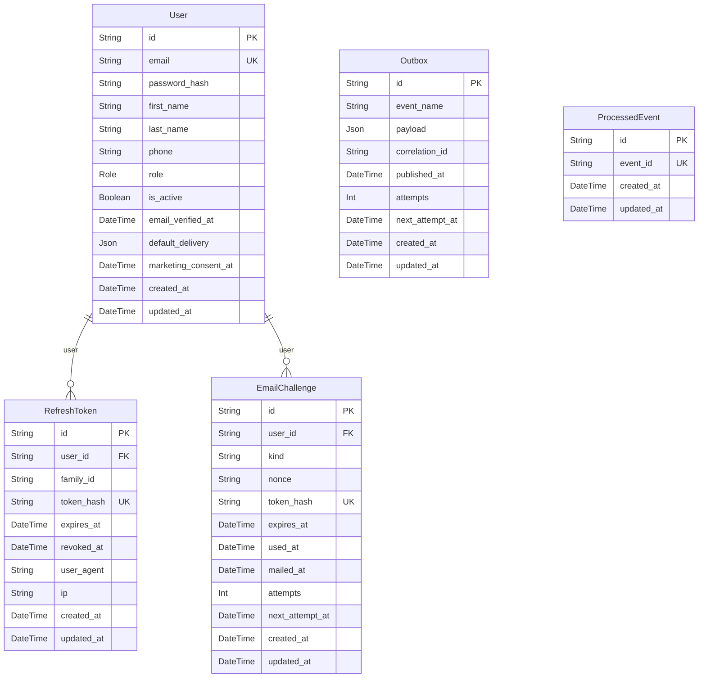
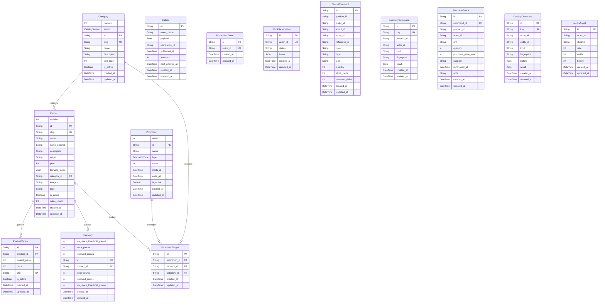
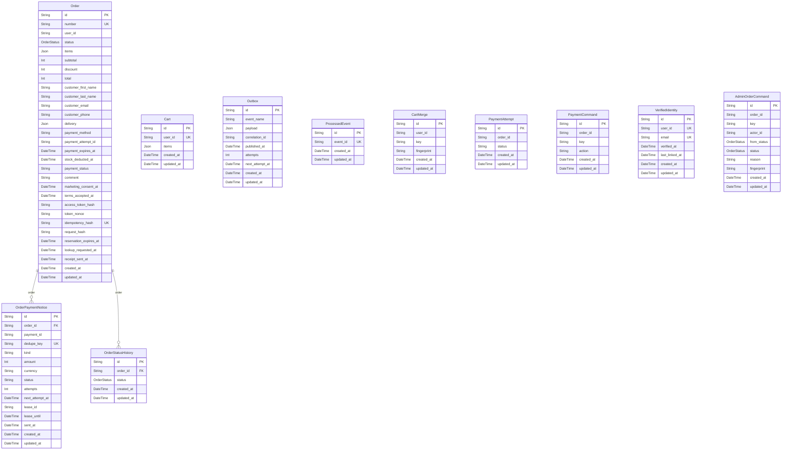
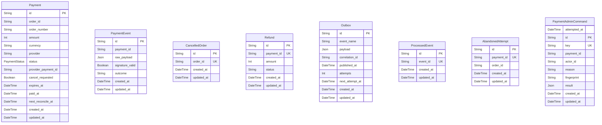
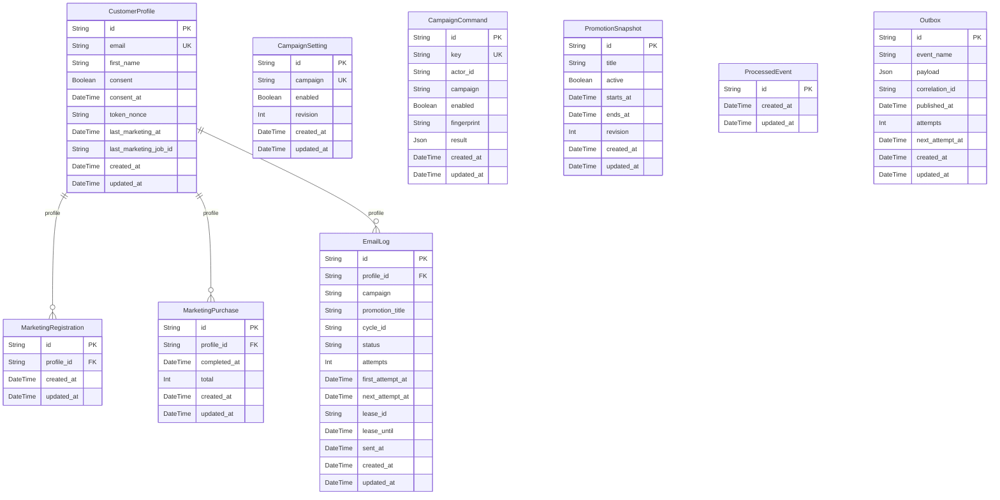

# Схема баз данных

Справочник построен по текущим `schema.prisma` пяти сервисов. Для каждой БД ниже приведены ER-схема всех моделей, назначение таблиц, полный перечень полей и ограничения из Prisma. Имена полей БД учитывают `@map`, имена таблиц — `@@map`. JSON-содержимое описано отдельно, поскольку Prisma не задает его внутреннюю структуру.

Пять БД могут работать на одном PostgreSQL-сервере. Пользователь каждого приложения имеет права на свою БД. Физические foreign keys ограничены своей БД. Идентификаторы `userId`, `orderId`, `paymentId` в другом сервисе являются логическими ссылками и синхронизируются через контракты, RPC и события.

## Как читать схемы

`PK` обозначает primary key, `UK` — уникальность одного поля, `FK` — физический внешний ключ из Prisma relation. Составная уникальность перечислена под таблицей. Nullable тип с `?` допускает NULL. Коллекции relations отсутствуют среди физических колонок и показаны ребрами. Обязательность родителя и уникальность FK определяют кратность. В схеме платежей логические связи описаны текстом, так как Prisma не объявляет соответствующие FK.

## Снимки и денежные значения

- `Order.items` содержит массив QuotedItem из contracts с product/variant ID, названием, slug, weightGrams, quantity, unitPrice и originalPrice. Итоги хранятся отдельными целочисленными полями.
- `Order.delivery` содержит method, city, address, при CARRIER_POINT — selection и подтвержденный fee. Ручная UKRPOSHTA_BRANCH хранит строковый номер отделения.
- `Cart.items` содержит variantId и quantity, а не доверенную сумму заказа.
- `StockReservation.items` хранит снимок единицы и объема резерва; обработчик поддерживает legacy граммовые записи.
- `PaymentEvent.rawPayload` хранит пришедшие data/signature и требует приватного доступа.
- `Outbox.payload` хранит envelope события, correlationId, name, version и типизированный payload.
- `result` в журналах команд фиксирует ответ для replay. `fingerprint`/`requestHash` связывают ключ с содержимым операции.

Суммы и цены — целые копейки UAH. 12345 означает 123,45 грн. Остатки чая — целые граммы, оборудования — целые штуки. Например, 2 × 50 г резервируют 100 г одного product inventory.

## auth-service

[Prisma schema](../../apps/auth-service/prisma/schema.prisma) · [Миграции](../../apps/auth-service/prisma/migrations)

Перечисления типов

- `Role` — `CUSTOMER`, `ADMIN`.

### User

Таблица `users`. Аккаунты, роли, hash пароля, проверка email и профиль доставки.

| Поле Prisma          | Колонка БД             | Тип         | Атрибуты                        |
| -------------------- | ---------------------- | ----------- | ------------------------------- |
| `id`                 | `id`                   | `String`    | `@id @default(uuid()) @db.Uuid` |
| `email`              | `email`                | `String`    | `@unique @db.VarChar(320)`      |
| `passwordHash`       | `password_hash`        | `String`    | —                               |
| `firstName`          | `first_name`           | `String`    | `@db.VarChar(100)`              |
| `lastName`           | `last_name`            | `String`    | `@db.VarChar(100)`              |
| `phone`              | `phone`                | `String?`   | `@db.VarChar(16)`               |
| `role`               | `role`                 | `Role`      | `@default(CUSTOMER)`            |
| `isActive`           | `is_active`            | `Boolean`   | `@default(true)`                |
| `emailVerifiedAt`    | `email_verified_at`    | `DateTime?` | —                               |
| `defaultDelivery`    | `default_delivery`     | `Json?`     | —                               |
| `marketingConsentAt` | `marketing_consent_at` | `DateTime?` | —                               |
| `createdAt`          | `created_at`           | `DateTime`  | `@default(now())`               |
| `updatedAt`          | `updated_at`           | `DateTime`  | `@updatedAt`                    |

### RefreshToken

Таблица `refresh_tokens`. Семейства сессий, hash refresh token, срок и отзыв.

| Поле Prisma | Колонка БД   | Тип         | Атрибуты                        |
| ----------- | ------------ | ----------- | ------------------------------- |
| `id`        | `id`         | `String`    | `@id @default(uuid()) @db.Uuid` |
| `userId`    | `user_id`    | `String`    | `@db.Uuid`                      |
| `familyId`  | `family_id`  | `String`    | `@db.Uuid`                      |
| `tokenHash` | `token_hash` | `String`    | `@unique @db.Char(64)`          |
| `expiresAt` | `expires_at` | `DateTime`  | —                               |
| `revokedAt` | `revoked_at` | `DateTime?` | —                               |
| `userAgent` | `user_agent` | `String?`   | `@db.VarChar(256)`              |
| `ip`        | `ip`         | `String?`   | `@db.VarChar(64)`               |
| `createdAt` | `created_at` | `DateTime`  | `@default(now())`               |
| `updatedAt` | `updated_at` | `DateTime`  | `@updatedAt`                    |

Ограничения и индексы

- `@@index([userId])`
- `@@index([familyId])`
- `@@index([expiresAt])`

### Outbox

Таблица `outbox`. Долговечные исходящие события, подтверждение публикации и повторы.

| Поле Prisma     | Колонка БД        | Тип         | Атрибуты          |
| --------------- | ----------------- | ----------- | ----------------- |
| `id`            | `id`              | `String`    | `@id @db.Uuid`    |
| `eventName`     | `event_name`      | `String`    | —                 |
| `payload`       | `payload`         | `Json`      | —                 |
| `correlationId` | `correlation_id`  | `String`    | —                 |
| `publishedAt`   | `published_at`    | `DateTime?` | —                 |
| `attempts`      | `attempts`        | `Int`       | `@default(0)`     |
| `nextAttemptAt` | `next_attempt_at` | `DateTime`  | `@default(now())` |
| `createdAt`     | `created_at`      | `DateTime`  | `@default(now())` |
| `updatedAt`     | `updated_at`      | `DateTime`  | `@updatedAt`      |

Ограничения и индексы

- `@@index([publishedAt, nextAttemptAt])`

### ProcessedEvent

Таблица `processed_events`. Дедупликация входящего event ID в локальной транзакции.

| Поле Prisma | Колонка БД   | Тип        | Атрибуты                        |
| ----------- | ------------ | ---------- | ------------------------------- |
| `id`        | `id`         | `String`   | `@id @default(uuid()) @db.Uuid` |
| `eventId`   | `event_id`   | `String`   | `@unique @db.Uuid`              |
| `createdAt` | `created_at` | `DateTime` | `@default(now())`               |
| `updatedAt` | `updated_at` | `DateTime` | `@updatedAt`                    |

### EmailChallenge

Таблица `email_challenges`. Одноразовые email-подтверждения и восстановление пароля с доставкой письма.

| Поле Prisma     | Колонка БД        | Тип         | Атрибуты                        |
| --------------- | ----------------- | ----------- | ------------------------------- |
| `id`            | `id`              | `String`    | `@id @default(uuid()) @db.Uuid` |
| `userId`        | `user_id`         | `String`    | `@db.Uuid`                      |
| `kind`          | `kind`            | `String`    | —                               |
| `nonce`         | `nonce`           | `String`    | —                               |
| `tokenHash`     | `token_hash`      | `String`    | `@unique @db.Char(64)`          |
| `expiresAt`     | `expires_at`      | `DateTime`  | —                               |
| `usedAt`        | `used_at`         | `DateTime?` | —                               |
| `mailedAt`      | `mailed_at`       | `DateTime?` | —                               |
| `attempts`      | `attempts`        | `Int`       | `@default(0)`                   |
| `nextAttemptAt` | `next_attempt_at` | `DateTime`  | `@default(now())`               |
| `createdAt`     | `created_at`      | `DateTime`  | `@default(now())`               |
| `updatedAt`     | `updated_at`      | `DateTime`  | `@updatedAt`                    |

Ограничения и индексы

- `@@index([userId,kind,createdAt])`
- `@@index([mailedAt,nextAttemptAt])`

Дополнительный SQL миграций

В просмотренных миграциях дополнительные CHECK и partial UNIQUE INDEX не обнаружены. Бизнес-ограничения также задаются в use cases и валидаторах.

## catalog-service

[Prisma schema](../../apps/catalog-service/prisma/schema.prisma) · [Миграции](../../apps/catalog-service/prisma/migrations)

Перечисления типов

- `CatalogSection` — `TEA`, `EQUIPMENT`.
- `PromotionType` — `PERCENT`, `FIXED`.

### Category

Таблица `categories`. Категории чая и оборудования, порядок, активность и версия редактирования.

| Поле Prisma   | Колонка БД    | Тип              | Атрибуты                        |
| ------------- | ------------- | ---------------- | ------------------------------- |
| `revision`    | `revision`    | `Int`            | `@default(0)`                   |
| `section`     | `section`     | `CatalogSection` | `@default(TEA)`                 |
| `id`          | `id`          | `String`         | `@id @default(uuid()) @db.Uuid` |
| `slug`        | `slug`        | `String`         | `@unique @db.VarChar(100)`      |
| `name`        | `name`        | `String`         | `@db.VarChar(150)`              |
| `description` | `description` | `String`         | `@default("")`                  |
| `sortOrder`   | `sort_order`  | `Int`            | `@default(0)`                   |
| `isActive`    | `is_active`   | `Boolean`        | `@default(true)`                |
| `createdAt`   | `created_at`  | `DateTime`       | `@default(now())`               |
| `updatedAt`   | `updated_at`  | `DateTime`       | `@updatedAt`                    |

Ограничения и индексы

- `@@index([section, isActive])`

### Product

Таблица `products`. Описание товара, категория, изображения, происхождение и версия.

| Поле Prisma    | Колонка БД      | Тип        | Атрибуты                        |
| -------------- | --------------- | ---------- | ------------------------------- |
| `revision`     | `revision`      | `Int`      | `@default(0)`                   |
| `id`           | `id`            | `String`   | `@id @default(uuid()) @db.Uuid` |
| `slug`         | `slug`          | `String`   | `@unique @db.VarChar(160)`      |
| `name`         | `name`          | `String`   | `@db.VarChar(200)`              |
| `nameOriginal` | `name_original` | `String`   | `@db.VarChar(200)`              |
| `description`  | `description`   | `String`   | —                               |
| `origin`       | `origin`        | `String`   | `@db.VarChar(150)`              |
| `year`         | `year`          | `Int?`     | —                               |
| `brewingGuide` | `brewing_guide` | `Json?`    | —                               |
| `categoryId`   | `category_id`   | `String`   | `@db.Uuid`                      |
| `images`       | `images`        | `String[]` | —                               |
| `tags`         | `tags`          | `String[]` | —                               |
| `isActive`     | `is_active`     | `Boolean`  | `@default(true)`                |
| `salesCount`   | `sales_count`   | `Int`      | `@default(0)`                   |
| `createdAt`    | `created_at`    | `DateTime` | `@default(now())`               |
| `updatedAt`    | `updated_at`    | `DateTime` | `@updatedAt`                    |

Ограничения и индексы

- `@@index([categoryId])`
- `@@index([createdAt])`
- `@@index([isActive, salesCount])`
- `@@index([origin])`

### ProductVariant

Таблица `product_variants`. SKU, цена в копейках и фасовка; nullable вес для поштучного оборудования.

| Поле Prisma   | Колонка БД     | Тип        | Атрибуты                        |
| ------------- | -------------- | ---------- | ------------------------------- |
| `id`          | `id`           | `String`   | `@id @default(uuid()) @db.Uuid` |
| `productId`   | `product_id`   | `String`   | `@db.Uuid`                      |
| `weightGrams` | `weight_grams` | `Int?`     | —                               |
| `price`       | `price`        | `Int`      | —                               |
| `sku`         | `sku`          | `String`   | `@unique @db.VarChar(100)`      |
| `isActive`    | `is_active`    | `Boolean`  | `@default(true)`                |
| `createdAt`   | `created_at`   | `DateTime` | `@default(now())`               |
| `updatedAt`   | `updated_at`   | `DateTime` | `@updatedAt`                    |

Ограничения и индексы

- `@@unique([productId, weightGrams])`
- `@@index([productId, isActive])`

### Inventory

Таблица `inventory`. Физический и зарезервированный остаток продукта в граммах и штуках.

| Поле Prisma               | Колонка БД                   | Тип        | Атрибуты                        |
| ------------------------- | ---------------------------- | ---------- | ------------------------------- |
| `lowStockThresholdPieces` | `low_stock_threshold_pieces` | `Int`      | `@default(3)`                   |
| `stockPieces`             | `stock_pieces`               | `Int`      | `@default(0)`                   |
| `reservedPieces`          | `reserved_pieces`            | `Int`      | `@default(0)`                   |
| `id`                      | `id`                         | `String`   | `@id @default(uuid()) @db.Uuid` |
| `productId`               | `product_id`                 | `String`   | `@unique @db.Uuid`              |
| `stockGrams`              | `stock_grams`                | `Int`      | `@default(0)`                   |
| `reservedGrams`           | `reserved_grams`             | `Int`      | `@default(0)`                   |
| `lowStockThresholdGrams`  | `low_stock_threshold_grams`  | `Int`      | `@default(100)`                 |
| `createdAt`               | `created_at`                 | `DateTime` | `@default(now())`               |
| `updatedAt`               | `updated_at`                 | `DateTime` | `@updatedAt`                    |

### Promotion

Таблица `promotions`. Срок действия, тип, значение и активность скидки.

| Поле Prisma | Колонка БД   | Тип             | Атрибуты                        |
| ----------- | ------------ | --------------- | ------------------------------- |
| `revision`  | `revision`   | `Int`           | `@default(0)`                   |
| `id`        | `id`         | `String`        | `@id @default(uuid()) @db.Uuid` |
| `name`      | `name`       | `String`        | —                               |
| `type`      | `type`       | `PromotionType` | —                               |
| `value`     | `value`      | `Int`           | —                               |
| `startsAt`  | `starts_at`  | `DateTime`      | —                               |
| `endsAt`    | `ends_at`    | `DateTime`      | —                               |
| `isActive`  | `is_active`  | `Boolean`       | `@default(true)`                |
| `createdAt` | `created_at` | `DateTime`      | `@default(now())`               |
| `updatedAt` | `updated_at` | `DateTime`      | `@updatedAt`                    |

Ограничения и индексы

- `@@index([isActive, startsAt, endsAt])`

### PromotionTarget

Таблица `promotion_targets`. Применение акции к товару или категории.

| Поле Prisma   | Колонка БД     | Тип        | Атрибуты                        |
| ------------- | -------------- | ---------- | ------------------------------- |
| `id`          | `id`           | `String`   | `@id @default(uuid()) @db.Uuid` |
| `promotionId` | `promotion_id` | `String`   | `@db.Uuid`                      |
| `productId`   | `product_id`   | `String?`  | `@db.Uuid`                      |
| `categoryId`  | `category_id`  | `String?`  | `@db.Uuid`                      |
| `createdAt`   | `created_at`   | `DateTime` | `@default(now())`               |
| `updatedAt`   | `updated_at`   | `DateTime` | `@updatedAt`                    |

Ограничения и индексы

- `@@unique([promotionId, productId])`
- `@@unique([promotionId, categoryId])`
- `@@index([productId])`
- `@@index([categoryId])`

### Outbox

Таблица `outbox`. Долговечные исходящие события, подтверждение публикации и повторы.

| Поле Prisma     | Колонка БД        | Тип         | Атрибуты          |
| --------------- | ----------------- | ----------- | ----------------- |
| `id`            | `id`              | `String`    | `@id @db.Uuid`    |
| `eventName`     | `event_name`      | `String`    | —                 |
| `payload`       | `payload`         | `Json`      | —                 |
| `correlationId` | `correlation_id`  | `String`    | —                 |
| `publishedAt`   | `published_at`    | `DateTime?` | —                 |
| `attempts`      | `attempts`        | `Int`       | `@default(0)`     |
| `nextAttemptAt` | `next_attempt_at` | `DateTime`  | `@default(now())` |
| `createdAt`     | `created_at`      | `DateTime`  | `@default(now())` |
| `updatedAt`     | `updated_at`      | `DateTime`  | `@updatedAt`      |

Ограничения и индексы

- `@@index([publishedAt, nextAttemptAt])`

### ProcessedEvent

Таблица `processed_events`. Дедупликация входящего event ID в локальной транзакции.

| Поле Prisma | Колонка БД   | Тип        | Атрибуты                        |
| ----------- | ------------ | ---------- | ------------------------------- |
| `id`        | `id`         | `String`   | `@id @default(uuid()) @db.Uuid` |
| `eventId`   | `event_id`   | `String`   | `@unique @db.Uuid`              |
| `createdAt` | `created_at` | `DateTime` | `@default(now())`               |
| `updatedAt` | `updated_at` | `DateTime` | `@updatedAt`                    |

### StockReservation

Таблица `stock_reservations`. Резерв по order ID и его состояние, включая след отмены для запоздалых событий.

| Поле Prisma | Колонка БД   | Тип        | Атрибуты                        |
| ----------- | ------------ | ---------- | ------------------------------- |
| `id`        | `id`         | `String`   | `@id @default(uuid()) @db.Uuid` |
| `orderId`   | `order_id`   | `String`   | `@unique @db.Uuid`              |
| `status`    | `status`     | `String`   | —                               |
| `items`     | `items`      | `Json`     | —                               |
| `createdAt` | `created_at` | `DateTime` | `@default(now())`               |
| `updatedAt` | `updated_at` | `DateTime` | `@updatedAt`                    |

### StockMovement

Таблица `stock_movements`. Журнал складского движения с единицей, количеством и источником.

| Поле Prisma     | Колонка БД       | Тип        | Атрибуты                        |
| --------------- | ---------------- | ---------- | ------------------------------- |
| `id`            | `id`             | `String`   | `@id @default(uuid()) @db.Uuid` |
| `productId`     | `product_id`     | `String`   | `@db.Uuid`                      |
| `orderId`       | `order_id`       | `String?`  | `@db.Uuid`                      |
| `eventId`       | `event_id`       | `String?`  | `@db.Uuid`                      |
| `actorId`       | `actor_id`       | `String?`  | `@db.Uuid`                      |
| `referenceId`   | `reference_id`   | `String?`  | `@db.Uuid`                      |
| `note`          | `note`           | `String`   | `@default("")`                  |
| `type`          | `type`           | `String`   | —                               |
| `unit`          | `unit`           | `String`   | —                               |
| `quantity`      | `quantity`       | `Int`      | —                               |
| `stockDelta`    | `stock_delta`    | `Int`      | —                               |
| `reservedDelta` | `reserved_delta` | `Int`      | —                               |
| `createdAt`     | `created_at`     | `DateTime` | `@default(now())`               |
| `updatedAt`     | `updated_at`     | `DateTime` | `@updatedAt`                    |

Ограничения и индексы

- `@@unique([eventId, productId, type])`
- `@@index([productId, createdAt])`
- `@@index([orderId, createdAt])`

### InventoryCommand

Таблица `inventory_commands`. Дедупликация и результат административной операции со складом.

| Поле Prisma   | Колонка БД    | Тип        | Атрибуты           |
| ------------- | ------------- | ---------- | ------------------ |
| `id`          | `id`          | `String`   | `@id @db.Uuid`     |
| `key`         | `key`         | `String`   | `@unique @db.Uuid` |
| `productId`   | `product_id`  | `String`   | `@db.Uuid`         |
| `actorId`     | `actor_id`    | `String`   | `@db.Uuid`         |
| `kind`        | `kind`        | `String`   | —                  |
| `fingerprint` | `fingerprint` | `String`   | `@db.Char(64)`     |
| `result`      | `result`      | `Json`     | —                  |
| `createdAt`   | `created_at`  | `DateTime` | `@default(now())`  |
| `updatedAt`   | `updated_at`  | `DateTime` | `@updatedAt`       |

Ограничения и индексы

- `@@index([productId, createdAt])`

### PurchaseBatch

Таблица `purchase_batches`. Приход товара, затраты и данные закупки.

| Поле Prisma          | Колонка БД             | Тип        | Атрибуты           |
| -------------------- | ---------------------- | ---------- | ------------------ |
| `id`                 | `id`                   | `String`   | `@id @db.Uuid`     |
| `commandId`          | `command_id`           | `String`   | `@unique @db.Uuid` |
| `productId`          | `product_id`           | `String`   | `@db.Uuid`         |
| `actorId`            | `actor_id`             | `String`   | `@db.Uuid`         |
| `unit`               | `unit`                 | `String`   | —                  |
| `quantity`           | `quantity`             | `Int`      | —                  |
| `purchasePriceTotal` | `purchase_price_total` | `Int`      | —                  |
| `supplier`           | `supplier`             | `String`   | —                  |
| `purchasedAt`        | `purchased_at`         | `DateTime` | —                  |
| `note`               | `note`                 | `String`   | —                  |
| `createdAt`          | `created_at`           | `DateTime` | `@default(now())`  |
| `updatedAt`          | `updated_at`           | `DateTime` | `@updatedAt`       |

Ограничения и индексы

- `@@index([productId, purchasedAt])`

### CatalogCommand

Таблица `catalog_commands`. Аудит и повторяемый результат изменения каталога или акции.

| Поле Prisma   | Колонка БД    | Тип        | Атрибуты           |
| ------------- | ------------- | ---------- | ------------------ |
| `id`          | `id`          | `String`   | `@id @db.Uuid`     |
| `key`         | `key`         | `String`   | `@unique @db.Uuid` |
| `actorId`     | `actor_id`    | `String`   | `@db.Uuid`         |
| `entityId`    | `entity_id`   | `String`   | `@db.Uuid`         |
| `kind`        | `kind`        | `String`   | —                  |
| `fingerprint` | `fingerprint` | `String`   | `@db.Char(64)`     |
| `before`      | `before`      | `Json?`    | —                  |
| `result`      | `result`      | `Json`     | —                  |
| `createdAt`   | `created_at`  | `DateTime` | `@default(now())`  |
| `updatedAt`   | `updated_at`  | `DateTime` | `@updatedAt`       |

Ограничения и индексы

- `@@index([entityId, createdAt])`

### MediaAsset

Таблица `media_assets`. Метаданные обработанного файла изображения; содержимое на диске.

| Поле Prisma | Колонка БД   | Тип        | Атрибуты          |
| ----------- | ------------ | ---------- | ----------------- |
| `id`        | `id`         | `String`   | `@id @db.Uuid`    |
| `actorId`   | `actor_id`   | `String`   | `@db.Uuid`        |
| `sha256`    | `sha256`     | `String`   | `@db.Char(64)`    |
| `size`      | `size`       | `Int`      | —                 |
| `width`     | `width`      | `Int`      | —                 |
| `height`    | `height`     | `Int`      | —                 |
| `createdAt` | `created_at` | `DateTime` | `@default(now())` |
| `updatedAt` | `updated_at` | `DateTime` | `@updatedAt`      |

Дополнительный SQL миграций

В просмотренных миграциях дополнительные CHECK и partial UNIQUE INDEX не обнаружены. Бизнес-ограничения также задаются в use cases и валидаторах.

## orders-service

[Prisma schema](../../apps/orders-service/prisma/schema.prisma) · [Миграции](../../apps/orders-service/prisma/migrations)

Перечисления типов

- `OrderStatus` — `PENDING`, `CONFIRMED`, `AWAITING_PAYMENT`, `PAID`, `REJECTED`, `CANCELLED`, `SHIPPED`, `COMPLETED`.

### Order

Таблица `orders`. Снимок заказа, контакты, суммы, доставка, текущая попытка и приватный доступ.

| Поле Prisma            | Колонка БД               | Тип           | Атрибуты                        |
| ---------------------- | ------------------------ | ------------- | ------------------------------- |
| `id`                   | `id`                     | `String`      | `@id @default(uuid()) @db.Uuid` |
| `number`               | `number`                 | `String`      | `@unique`                       |
| `userId`               | `user_id`                | `String?`     | `@db.Uuid`                      |
| `status`               | `status`                 | `OrderStatus` | `@default(PENDING)`             |
| `items`                | `items`                  | `Json`        | —                               |
| `subtotal`             | `subtotal`               | `Int`         | —                               |
| `discount`             | `discount`               | `Int`         | —                               |
| `total`                | `total`                  | `Int`         | —                               |
| `firstName`            | `customer_first_name`    | `String`      | —                               |
| `lastName`             | `customer_last_name`     | `String`      | —                               |
| `email`                | `customer_email`         | `String`      | —                               |
| `phone`                | `customer_phone`         | `String`      | —                               |
| `delivery`             | `delivery`               | `Json`        | —                               |
| `paymentMethod`        | `payment_method`         | `String`      | `@default("CASH_ON_DELIVERY")`  |
| `paymentAttemptId`     | `payment_attempt_id`     | `String?`     | `@db.Uuid`                      |
| `paymentExpiresAt`     | `payment_expires_at`     | `DateTime?`   | —                               |
| `stockDeductedAt`      | `stock_deducted_at`      | `DateTime?`   | —                               |
| `paymentStatus`        | `payment_status`         | `String`      | `@default("UNPAID")`            |
| `comment`              | `comment`                | `String`      | `@default("")`                  |
| `marketingConsentAt`   | `marketing_consent_at`   | `DateTime?`   | —                               |
| `termsAcceptedAt`      | `terms_accepted_at`      | `DateTime`    | `@default(now())`               |
| `accessTokenHash`      | `access_token_hash`      | `String`      | `@db.Char(64)`                  |
| `tokenNonce`           | `token_nonce`            | `String`      | —                               |
| `idempotencyHash`      | `idempotency_hash`       | `String`      | `@unique @db.Char(64)`          |
| `requestHash`          | `request_hash`           | `String`      | `@db.Char(64)`                  |
| `reservationExpiresAt` | `reservation_expires_at` | `DateTime`    | —                               |
| `lookupRequestedAt`    | `lookup_requested_at`    | `DateTime?`   | —                               |
| `receiptSentAt`        | `receipt_sent_at`        | `DateTime?`   | —                               |
| `createdAt`            | `created_at`             | `DateTime`    | `@default(now())`               |
| `updatedAt`            | `updated_at`             | `DateTime`    | `@updatedAt`                    |

Ограничения и индексы

- `@@index([userId, createdAt])`
- `@@index([email,createdAt])`
- `@@index([status, reservationExpiresAt])`
- `@@index([receiptSentAt])`
- `@@index([status,paymentExpiresAt])`

### OrderPaymentNotice

Таблица `order_payment_notices`. Общая очередь писем об оплате, fulfillment и новом заказе владельцу.

| Поле Prisma     | Колонка БД        | Тип         | Атрибуты                        |
| --------------- | ----------------- | ----------- | ------------------------------- |
| `id`            | `id`              | `String`    | `@id @default(uuid()) @db.Uuid` |
| `orderId`       | `order_id`        | `String`    | `@db.Uuid`                      |
| `paymentId`     | `payment_id`      | `String?`   | `@db.Uuid`                      |
| `dedupeKey`     | `dedupe_key`      | `String?`   | `@unique`                       |
| `kind`          | `kind`            | `String`    | —                               |
| `amount`        | `amount`          | `Int`       | —                               |
| `currency`      | `currency`        | `String`    | `@default("UAH")`               |
| `status`        | `status`          | `String`    | `@default("PENDING")`           |
| `attempts`      | `attempts`        | `Int`       | `@default(0)`                   |
| `nextAttemptAt` | `next_attempt_at` | `DateTime`  | `@default(now())`               |
| `leaseId`       | `lease_id`        | `String?`   | `@db.Uuid`                      |
| `leaseUntil`    | `lease_until`     | `DateTime?` | —                               |
| `sentAt`        | `sent_at`         | `DateTime?` | —                               |
| `createdAt`     | `created_at`      | `DateTime`  | `@default(now())`               |
| `updatedAt`     | `updated_at`      | `DateTime`  | `@updatedAt`                    |

Ограничения и индексы

- `@@unique([paymentId,kind])`
- `@@index([status,nextAttemptAt,leaseUntil])`
- `@@index([orderId,createdAt])`

### OrderStatusHistory

Таблица `order_status_history`. Локальная история статусов заказа.

| Поле Prisma | Колонка БД   | Тип           | Атрибуты                        |
| ----------- | ------------ | ------------- | ------------------------------- |
| `id`        | `id`         | `String`      | `@id @default(uuid()) @db.Uuid` |
| `orderId`   | `order_id`   | `String`      | `@db.Uuid`                      |
| `status`    | `status`     | `OrderStatus` | —                               |
| `createdAt` | `created_at` | `DateTime`    | `@default(now())`               |
| `updatedAt` | `updated_at` | `DateTime`    | `@updatedAt`                    |

Ограничения и индексы

- `@@index([orderId, createdAt])`

### Cart

Таблица `carts`. Серверная корзина пользователя в JSON.

| Поле Prisma | Колонка БД   | Тип        | Атрибуты                        |
| ----------- | ------------ | ---------- | ------------------------------- |
| `id`        | `id`         | `String`   | `@id @default(uuid()) @db.Uuid` |
| `userId`    | `user_id`    | `String`   | `@unique @db.Uuid`              |
| `items`     | `items`      | `Json`     | —                               |
| `createdAt` | `created_at` | `DateTime` | `@default(now())`               |
| `updatedAt` | `updated_at` | `DateTime` | `@updatedAt`                    |

### Outbox

Таблица `outbox`. Долговечные исходящие события, подтверждение публикации и повторы.

| Поле Prisma     | Колонка БД        | Тип         | Атрибуты          |
| --------------- | ----------------- | ----------- | ----------------- |
| `id`            | `id`              | `String`    | `@id @db.Uuid`    |
| `eventName`     | `event_name`      | `String`    | —                 |
| `payload`       | `payload`         | `Json`      | —                 |
| `correlationId` | `correlation_id`  | `String`    | —                 |
| `publishedAt`   | `published_at`    | `DateTime?` | —                 |
| `attempts`      | `attempts`        | `Int`       | `@default(0)`     |
| `nextAttemptAt` | `next_attempt_at` | `DateTime`  | `@default(now())` |
| `createdAt`     | `created_at`      | `DateTime`  | `@default(now())` |
| `updatedAt`     | `updated_at`      | `DateTime`  | `@updatedAt`      |

Ограничения и индексы

- `@@index([publishedAt, nextAttemptAt])`

### ProcessedEvent

Таблица `processed_events`. Дедупликация входящего event ID в локальной транзакции.

| Поле Prisma | Колонка БД   | Тип        | Атрибуты                        |
| ----------- | ------------ | ---------- | ------------------------------- |
| `id`        | `id`         | `String`   | `@id @default(uuid()) @db.Uuid` |
| `eventId`   | `event_id`   | `String`   | `@unique @db.Uuid`              |
| `createdAt` | `created_at` | `DateTime` | `@default(now())`               |
| `updatedAt` | `updated_at` | `DateTime` | `@updatedAt`                    |

### CartMerge

Таблица `cart_merges`. Дедупликация объединения гостевой корзины с аккаунтом.

| Поле Prisma   | Колонка БД    | Тип        | Атрибуты                        |
| ------------- | ------------- | ---------- | ------------------------------- |
| `id`          | `id`          | `String`   | `@id @default(uuid()) @db.Uuid` |
| `userId`      | `user_id`     | `String`   | `@db.Uuid`                      |
| `key`         | `key`         | `String`   | `@db.Uuid`                      |
| `fingerprint` | `fingerprint` | `String`   | `@db.Char(64)`                  |
| `createdAt`   | `created_at`  | `DateTime` | `@default(now())`               |
| `updatedAt`   | `updated_at`  | `DateTime` | `@updatedAt`                    |

Ограничения и индексы

- `@@unique([userId, key])`

### PaymentAttempt

Таблица `payment_attempts`. Локальная проекция истории платежных попыток заказа.

| Поле Prisma | Колонка БД   | Тип        | Атрибуты              |
| ----------- | ------------ | ---------- | --------------------- |
| `id`        | `id`         | `String`   | `@id @db.Uuid`        |
| `orderId`   | `order_id`   | `String`   | `@db.Uuid`            |
| `status`    | `status`     | `String`   | `@default("PENDING")` |
| `createdAt` | `created_at` | `DateTime` | `@default(now())`     |
| `updatedAt` | `updated_at` | `DateTime` | `@updatedAt`          |

Ограничения и индексы

- `@@index([orderId,createdAt])`

### PaymentCommand

Таблица `payment_commands`. Журнал команд retry или смены на COD по order ID и key.

| Поле Prisma | Колонка БД   | Тип        | Атрибуты                        |
| ----------- | ------------ | ---------- | ------------------------------- |
| `id`        | `id`         | `String`   | `@id @default(uuid()) @db.Uuid` |
| `orderId`   | `order_id`   | `String`   | `@db.Uuid`                      |
| `key`       | `key`        | `String`   | `@db.Uuid`                      |
| `action`    | `action`     | `String`   | —                               |
| `createdAt` | `created_at` | `DateTime` | `@default(now())`               |
| `updatedAt` | `updated_at` | `DateTime` | `@updatedAt`                    |

Ограничения и индексы

- `@@unique([orderId,key])`

### VerifiedIdentity

Таблица `verified_identities`. Подтвержденная identity из auth для связи гостевых покупок.

| Поле Prisma    | Колонка БД       | Тип        | Атрибуты                        |
| -------------- | ---------------- | ---------- | ------------------------------- |
| `id`           | `id`             | `String`   | `@id @default(uuid()) @db.Uuid` |
| `userId`       | `user_id`        | `String`   | `@unique @db.Uuid`              |
| `email`        | `email`          | `String`   | `@unique`                       |
| `verifiedAt`   | `verified_at`    | `DateTime` | —                               |
| `lastLinkedAt` | `last_linked_at` | `DateTime` | `@default(now())`               |
| `createdAt`    | `created_at`     | `DateTime` | `@default(now())`               |
| `updatedAt`    | `updated_at`     | `DateTime` | `@updatedAt`                    |

Ограничения и индексы

- `@@index([lastLinkedAt])`

### AdminOrderCommand

Таблица `admin_order_commands`. Аудит и идемпотентность административного перехода статуса.

| Поле Prisma   | Колонка БД    | Тип           | Атрибуты                        |
| ------------- | ------------- | ------------- | ------------------------------- |
| `id`          | `id`          | `String`      | `@id @default(uuid()) @db.Uuid` |
| `orderId`     | `order_id`    | `String`      | `@db.Uuid`                      |
| `key`         | `key`         | `String`      | `@db.Uuid`                      |
| `actorId`     | `actor_id`    | `String`      | `@db.Uuid`                      |
| `fromStatus`  | `from_status` | `OrderStatus` | —                               |
| `status`      | `status`      | `OrderStatus` | —                               |
| `reason`      | `reason`      | `String`      | —                               |
| `fingerprint` | `fingerprint` | `String`      | `@db.Char(64)`                  |
| `createdAt`   | `created_at`  | `DateTime`    | `@default(now())`               |
| `updatedAt`   | `updated_at`  | `DateTime`    | `@updatedAt`                    |

Ограничения и индексы

- `@@unique([orderId,key])`
- `@@index([orderId,createdAt])`

Дополнительный SQL миграций

В просмотренных миграциях дополнительные CHECK и partial UNIQUE INDEX не обнаружены. Бизнес-ограничения также задаются в use cases и валидаторах.

## payments-service

[Prisma schema](../../apps/payments-service/prisma/schema.prisma) · [Миграции](../../apps/payments-service/prisma/migrations)

Перечисления типов

- `PaymentStatus` — `CREATED`, `PENDING`, `SUCCEEDED`, `FAILED`, `EXPIRED`, `REFUNDED`, `PARTIALLY_REFUNDED`.

### Payment

Таблица `payments`. Ledger попытки онлайн-оплаты, сумма, провайдер, статус и reconciliation deadline.

| Поле Prisma         | Колонка БД            | Тип             | Атрибуты            |
| ------------------- | --------------------- | --------------- | ------------------- |
| `id`                | `id`                  | `String`        | `@id @db.Uuid`      |
| `orderId`           | `order_id`            | `String`        | `@db.Uuid`          |
| `orderNumber`       | `order_number`        | `String`        | —                   |
| `amount`            | `amount`              | `Int`           | —                   |
| `currency`          | `currency`            | `String`        | —                   |
| `provider`          | `provider`            | `String`        | —                   |
| `status`            | `status`              | `PaymentStatus` | `@default(CREATED)` |
| `providerPaymentId` | `provider_payment_id` | `String?`       | —                   |
| `cancelRequested`   | `cancel_requested`    | `Boolean`       | `@default(false)`   |
| `expiresAt`         | `expires_at`          | `DateTime`      | —                   |
| `paidAt`            | `paid_at`             | `DateTime?`     | —                   |
| `nextReconcileAt`   | `next_reconcile_at`   | `DateTime`      | `@default(now())`   |
| `createdAt`         | `created_at`          | `DateTime`      | `@default(now())`   |
| `updatedAt`         | `updated_at`          | `DateTime`      | `@updatedAt`        |

Ограничения и индексы

- `@@index([orderId,createdAt])`
- `@@index([createdAt])`
- `@@index([status,expiresAt])`
- `@@index([status,nextReconcileAt])`

### PaymentEvent

Таблица `payment_events`. Raw webhook envelope, результат проверки подписи и outcome обработки.

| Поле Prisma      | Колонка БД        | Тип        | Атрибуты                        |
| ---------------- | ----------------- | ---------- | ------------------------------- |
| `id`             | `id`              | `String`   | `@id @default(uuid()) @db.Uuid` |
| `paymentId`      | `payment_id`      | `String?`  | `@db.Uuid`                      |
| `rawPayload`     | `raw_payload`     | `Json`     | —                               |
| `signatureValid` | `signature_valid` | `Boolean`  | —                               |
| `outcome`        | `outcome`         | `String`   | `@default("RECEIVED")`          |
| `createdAt`      | `created_at`      | `DateTime` | `@default(now())`               |
| `updatedAt`      | `updated_at`      | `DateTime` | `@updatedAt`                    |

Ограничения и индексы

- `@@index([paymentId,createdAt])`
- `@@index([createdAt])`

### CancelledOrder

Таблица `cancelled_orders`. Tombstone отмены, в том числе полученной до создания payment.

| Поле Prisma | Колонка БД   | Тип        | Атрибуты                        |
| ----------- | ------------ | ---------- | ------------------------------- |
| `id`        | `id`         | `String`   | `@id @default(uuid()) @db.Uuid` |
| `orderId`   | `order_id`   | `String`   | `@unique @db.Uuid`              |
| `createdAt` | `created_at` | `DateTime` | `@default(now())`               |
| `updatedAt` | `updated_at` | `DateTime` | `@updatedAt`                    |

### Refund

Таблица `refunds`. Уникальная задача компенсационного возврата по платежу.

| Поле Prisma | Колонка БД   | Тип        | Атрибуты                        |
| ----------- | ------------ | ---------- | ------------------------------- |
| `id`        | `id`         | `String`   | `@id @default(uuid()) @db.Uuid` |
| `paymentId` | `payment_id` | `String`   | `@unique @db.Uuid`              |
| `amount`    | `amount`     | `Int`      | —                               |
| `status`    | `status`     | `String`   | `@default("REQUESTED")`         |
| `createdAt` | `created_at` | `DateTime` | `@default(now())`               |
| `updatedAt` | `updated_at` | `DateTime` | `@updatedAt`                    |

Ограничения и индексы

- `@@index([status,createdAt])`

### Outbox

Таблица `outbox`. Долговечные исходящие события, подтверждение публикации и повторы.

| Поле Prisma     | Колонка БД        | Тип         | Атрибуты          |
| --------------- | ----------------- | ----------- | ----------------- |
| `id`            | `id`              | `String`    | `@id @db.Uuid`    |
| `eventName`     | `event_name`      | `String`    | —                 |
| `payload`       | `payload`         | `Json`      | —                 |
| `correlationId` | `correlation_id`  | `String`    | —                 |
| `publishedAt`   | `published_at`    | `DateTime?` | —                 |
| `attempts`      | `attempts`        | `Int`       | `@default(0)`     |
| `nextAttemptAt` | `next_attempt_at` | `DateTime`  | `@default(now())` |
| `createdAt`     | `created_at`      | `DateTime`  | `@default(now())` |
| `updatedAt`     | `updated_at`      | `DateTime`  | `@updatedAt`      |

Ограничения и индексы

- `@@index([publishedAt, nextAttemptAt])`

### ProcessedEvent

Таблица `processed_events`. Дедупликация входящего event ID в локальной транзакции.

| Поле Prisma | Колонка БД   | Тип        | Атрибуты                        |
| ----------- | ------------ | ---------- | ------------------------------- |
| `id`        | `id`         | `String`   | `@id @default(uuid()) @db.Uuid` |
| `eventId`   | `event_id`   | `String`   | `@unique @db.Uuid`              |
| `createdAt` | `created_at` | `DateTime` | `@default(now())`               |
| `updatedAt` | `updated_at` | `DateTime` | `@updatedAt`                    |

### AbandonedAttempt

Таблица `abandoned_attempts`. Маркер оставленной попытки при retry или смене способа оплаты.

| Поле Prisma | Колонка БД   | Тип        | Атрибуты                        |
| ----------- | ------------ | ---------- | ------------------------------- |
| `id`        | `id`         | `String`   | `@id @default(uuid()) @db.Uuid` |
| `paymentId` | `payment_id` | `String`   | `@unique @db.Uuid`              |
| `orderId`   | `order_id`   | `String`   | `@db.Uuid`                      |
| `createdAt` | `created_at` | `DateTime` | `@default(now())`               |
| `updatedAt` | `updated_at` | `DateTime` | `@updatedAt`                    |

Ограничения и индексы

- `@@index([orderId])`

### PaymentAdminCommand

Таблица `payment_admin_commands`. Аудит запроса сверки платежа и отметка выполнения.

| Поле Prisma   | Колонка БД     | Тип         | Атрибуты                        |
| ------------- | -------------- | ----------- | ------------------------------- |
| `attemptedAt` | `attempted_at` | `DateTime?` | —                               |
| `id`          | `id`           | `String`    | `@id @default(uuid()) @db.Uuid` |
| `key`         | `key`          | `String`    | `@unique @db.Uuid`              |
| `paymentId`   | `payment_id`   | `String`    | `@db.Uuid`                      |
| `actorId`     | `actor_id`     | `String`    | `@db.Uuid`                      |
| `reason`      | `reason`       | `String`    | —                               |
| `fingerprint` | `fingerprint`  | `String`    | `@db.Char(64)`                  |
| `result`      | `result`       | `Json`      | —                               |
| `createdAt`   | `created_at`   | `DateTime`  | `@default(now())`               |
| `updatedAt`   | `updated_at`   | `DateTime`  | `@updatedAt`                    |

Ограничения и индексы

- `@@index([paymentId,createdAt])`
- `@@index([attemptedAt,createdAt])`

Дополнительный SQL миграций

В просмотренных миграциях дополнительные CHECK и partial UNIQUE INDEX не обнаружены. Бизнес-ограничения также задаются в use cases и валидаторах.

## marketing-service

[Prisma schema](../../apps/marketing-service/prisma/schema.prisma) · [Миграции](../../apps/marketing-service/prisma/migrations)

### CustomerProfile

Таблица `customer_profiles`. Маркетинговый профиль по email, согласие, покупки и последняя отправка.

| Поле Prisma          | Колонка БД              | Тип         | Атрибуты                        |
| -------------------- | ----------------------- | ----------- | ------------------------------- |
| `id`                 | `id`                    | `String`    | `@id @default(uuid()) @db.Uuid` |
| `email`              | `email`                 | `String`    | `@unique`                       |
| `firstName`          | `first_name`            | `String`    | —                               |
| `consent`            | `consent`               | `Boolean`   | `@default(false)`               |
| `consentAt`          | `consent_at`            | `DateTime?` | —                               |
| `tokenNonce`         | `token_nonce`           | `String`    | —                               |
| `lastMarketingAt`    | `last_marketing_at`     | `DateTime?` | —                               |
| `lastMarketingJobId` | `last_marketing_job_id` | `String?`   | `@db.Uuid`                      |
| `createdAt`          | `created_at`            | `DateTime`  | `@default(now())`               |
| `updatedAt`          | `updated_at`            | `DateTime`  | `@updatedAt`                    |

Ограничения и индексы

- `@@index([consent,lastMarketingAt])`

### MarketingRegistration

Таблица `marketing_registrations`. Дедупликация регистрации и ее связь с маркетинговым профилем.

| Поле Prisma | Колонка БД   | Тип        | Атрибуты          |
| ----------- | ------------ | ---------- | ----------------- |
| `id`        | `id`         | `String`   | `@id @db.Uuid`    |
| `profileId` | `profile_id` | `String`   | `@db.Uuid`        |
| `createdAt` | `created_at` | `DateTime` | `@default(now())` |
| `updatedAt` | `updated_at` | `DateTime` | `@updatedAt`      |

### MarketingPurchase

Таблица `marketing_purchases`. Проекция завершенной покупки с привязкой к профилю.

| Поле Prisma   | Колонка БД     | Тип        | Атрибуты          |
| ------------- | -------------- | ---------- | ----------------- |
| `id`          | `id`           | `String`   | `@id @db.Uuid`    |
| `profileId`   | `profile_id`   | `String`   | `@db.Uuid`        |
| `completedAt` | `completed_at` | `DateTime` | —                 |
| `total`       | `total`        | `Int`      | —                 |
| `createdAt`   | `created_at`   | `DateTime` | `@default(now())` |
| `updatedAt`   | `updated_at`   | `DateTime` | `@updatedAt`      |

Ограничения и индексы

- `@@index([profileId,completedAt])`

### EmailLog

Таблица `email_logs`. Маркетинговое письмо, кампания, цикл, lease, попытки и результат.

| Поле Prisma      | Колонка БД         | Тип         | Атрибуты                        |
| ---------------- | ------------------ | ----------- | ------------------------------- |
| `id`             | `id`               | `String`    | `@id @default(uuid()) @db.Uuid` |
| `profileId`      | `profile_id`       | `String`    | `@db.Uuid`                      |
| `campaign`       | `campaign`         | `String`    | —                               |
| `promotionTitle` | `promotion_title`  | `String?`   | —                               |
| `cycleId`        | `cycle_id`         | `String`    | `@db.Uuid`                      |
| `status`         | `status`           | `String`    | `@default("PENDING")`           |
| `attempts`       | `attempts`         | `Int`       | `@default(0)`                   |
| `firstAttemptAt` | `first_attempt_at` | `DateTime?` | —                               |
| `nextAttemptAt`  | `next_attempt_at`  | `DateTime`  | `@default(now())`               |
| `leaseId`        | `lease_id`         | `String?`   | `@db.Uuid`                      |
| `leaseUntil`     | `lease_until`      | `DateTime?` | —                               |
| `sentAt`         | `sent_at`          | `DateTime?` | —                               |
| `createdAt`      | `created_at`       | `DateTime`  | `@default(now())`               |
| `updatedAt`      | `updated_at`       | `DateTime`  | `@updatedAt`                    |

Ограничения и индексы

- `@@unique([profileId,campaign,cycleId])`
- `@@index([status,nextAttemptAt,leaseUntil])`

### CampaignSetting

Таблица `campaign_settings`. Включение кампании и revision настроек.

| Поле Prisma | Колонка БД   | Тип        | Атрибуты                        |
| ----------- | ------------ | ---------- | ------------------------------- |
| `id`        | `id`         | `String`   | `@id @default(uuid()) @db.Uuid` |
| `campaign`  | `campaign`   | `String`   | `@unique`                       |
| `enabled`   | `enabled`    | `Boolean`  | `@default(false)`               |
| `revision`  | `revision`   | `Int`      | `@default(0)`                   |
| `createdAt` | `created_at` | `DateTime` | `@default(now())`               |
| `updatedAt` | `updated_at` | `DateTime` | `@updatedAt`                    |

### CampaignCommand

Таблица `campaign_commands`. Аудит изменения настроек рассылки и replay result.

| Поле Prisma   | Колонка БД    | Тип        | Атрибуты                        |
| ------------- | ------------- | ---------- | ------------------------------- |
| `id`          | `id`          | `String`   | `@id @default(uuid()) @db.Uuid` |
| `key`         | `key`         | `String`   | `@unique @db.Uuid`              |
| `actorId`     | `actor_id`    | `String`   | `@db.Uuid`                      |
| `campaign`    | `campaign`    | `String`   | —                               |
| `enabled`     | `enabled`     | `Boolean`  | —                               |
| `fingerprint` | `fingerprint` | `String`   | `@db.Char(64)`                  |
| `result`      | `result`      | `Json`     | —                               |
| `createdAt`   | `created_at`  | `DateTime` | `@default(now())`               |
| `updatedAt`   | `updated_at`  | `DateTime` | `@updatedAt`                    |

Ограничения и индексы

- `@@index([createdAt])`

### PromotionSnapshot

Таблица `promotion_snapshots`. Локальная проекция метаданных акций из catalog RPC.

| Поле Prisma | Колонка БД   | Тип        | Атрибуты          |
| ----------- | ------------ | ---------- | ----------------- |
| `id`        | `id`         | `String`   | `@id @db.Uuid`    |
| `title`     | `title`      | `String`   | —                 |
| `active`    | `active`     | `Boolean`  | —                 |
| `startsAt`  | `starts_at`  | `DateTime` | —                 |
| `endsAt`    | `ends_at`    | `DateTime` | —                 |
| `revision`  | `revision`   | `Int`      | —                 |
| `createdAt` | `created_at` | `DateTime` | `@default(now())` |
| `updatedAt` | `updated_at` | `DateTime` | `@updatedAt`      |

Ограничения и индексы

- `@@index([active,startsAt,endsAt])`

### ProcessedEvent

Таблица `processed_events`. Дедупликация входящего event ID в локальной транзакции.

| Поле Prisma | Колонка БД   | Тип        | Атрибуты          |
| ----------- | ------------ | ---------- | ----------------- |
| `id`        | `id`         | `String`   | `@id @db.Uuid`    |
| `createdAt` | `created_at` | `DateTime` | `@default(now())` |
| `updatedAt` | `updated_at` | `DateTime` | `@updatedAt`      |

### Outbox

Таблица `outbox`. Долговечные исходящие события, подтверждение публикации и повторы.

| Поле Prisma     | Колонка БД        | Тип         | Атрибуты          |
| --------------- | ----------------- | ----------- | ----------------- |
| `id`            | `id`              | `String`    | `@id @db.Uuid`    |
| `eventName`     | `event_name`      | `String`    | —                 |
| `payload`       | `payload`         | `Json`      | —                 |
| `correlationId` | `correlation_id`  | `String`    | —                 |
| `publishedAt`   | `published_at`    | `DateTime?` | —                 |
| `attempts`      | `attempts`        | `Int`       | `@default(0)`     |
| `nextAttemptAt` | `next_attempt_at` | `DateTime`  | `@default(now())` |
| `createdAt`     | `created_at`      | `DateTime`  | `@default(now())` |
| `updatedAt`     | `updated_at`      | `DateTime`  | `@updatedAt`      |

Ограничения и индексы

- `@@index([publishedAt,nextAttemptAt])`

Дополнительный SQL миграций

В просмотренных миграциях дополнительные CHECK и partial UNIQUE INDEX не обнаружены. Бизнес-ограничения также задаются в use cases и валидаторах.

## Логические связи между сервисами

`orders.user_id` сопоставляется с `auth.users.id` после проверки личности. `payments.order_id` соответствует `orders.id`, а `orders.payment_attempt_id` — `payments.id`. Идентификаторы product/variant в JSON заказа соответствуют catalog, но старый снимок заказа сохраняет купленные названия и цены независимо от дальнейшего редактирования каталога. MarketingPurchase связывается с order ID события OrderCompleted, а MarketingRegistration — с user ID события UserRegistered.

Идентичное имя Outbox или ProcessedEvent в разных БД означает отдельные таблицы каждого сервиса. Межсервисные JOIN не используются. Сбой обновления одной проекции устраняется повторной доставкой события, а не прямой записью в соседнюю БД.

## Индексы и производительность

Составной индекс полезен для запросов, соответствующих его ведущим колонкам. `[status, nextAttemptAt, leaseUntil]` ускоряет выборку очереди писем, `[userId, createdAt]` — историю пользователя, `[status, nextReconcileAt]` — планирование сверки. Уникальный `(paymentId, kind)` предотвращает повтор уведомления по попытке, а dedupeKey охватывает письма без payment ID. Idempotency hash заказа и ключи command-таблиц защищают повторные записи на уровне БД.

Полнотекстовый поисковый индекс и гарантированная скорость поиска под большой нагрузкой не заявлены. Сначала исследуют EXPLAIN ANALYZE на реальном объеме, затем выбирают подходящий индекс или отдельный поисковый механизм. OFFSET pagination административных списков требует оценки стоимости на больших страницах.

## Транзакции и миграции

Prisma schema показывает желаемую структуру, а migrations содержат историю создания и дополнительных SQL-ограничений. Применять изменения следует через Prisma Migrate. Для проверки конкретного развернутого сервера нужно дополнительно сверить migrate status и реальные таблицы: эта глава описывает структуру репозитория.

Подробности row locks, advisory locks, RepeatableRead и отсутствия общей транзакции между сервисами приведены в [архитектурной главе](README.md#конкурентные-запросы). Ручное изменение статусов в SQL обходит Outbox, журналы команд и бизнес-переходы, поэтому не является нормальным способом работы владельца.
