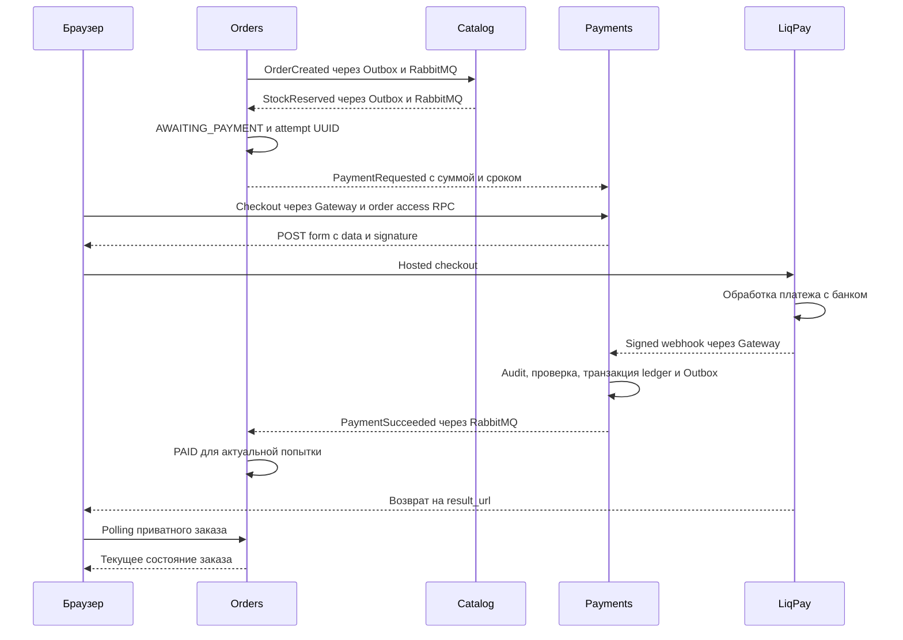
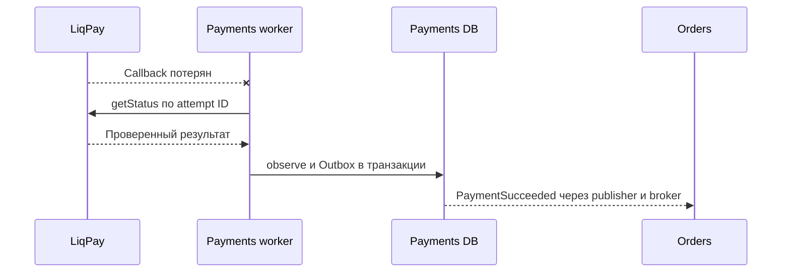

# Как работает платежная система

Глава описывает реализованный код Tea Element. Здесь «оплата подтверждена» означает подтвержденное наблюдение платежного провайдера, примененное к локальной попытке. Фактическое подключение мерчанта, условия банка и выплаты владельцу должны проверяться с провайдером при запуске.

## Участники и деньги

Покупатель выбирает товар. Магазин создает заказ и сумму. Платежный провайдер предоставляет страницу оплаты, взаимодействует с банками и уведомляет магазин. Банк покупателя списывает деньги, а провайдер рассчитывается с продавцом по условиям его договора.

В коде магазина не хранится номер карты владельца для получения онлайн-оплат. Он хранит merchant public/private keys LiqPay. Получатель средств и реквизиты выплат определяются аккаунтом мерчанта. `ORDER_OWNER_EMAIL` задает адрес уведомлений владельцу. Платежных реквизитов эта настройка не задает.

Для наложенного платежа сайт создает заказ с CASH_ON_DELIVERY. Перевозчику при оформлении посылки отдельно задается сумма наложенного платежа. Программного получения денег от NovaPay и автоматической сверки получения наложенного платежа в проекте нет. В текущем fulfillment завершение COD-заказа администратором фиксирует оплату; перед этим владелец должен проверить реальное получение средств.

## Заказ и попытка оплаты

Заказ отвечает на вопросы «что заказали, кому доставить, какой резерв и можно ли отправлять». Payment отвечает на вопросы «какая попытка была направлена провайдеру, на какую сумму и что он сообщил».

У заказа может быть несколько payment attempts. Нельзя использовать order ID как единственную запись оплаты: первая попытка может завершиться поздно после того, как покупатель уже начал вторую. Каждая попытка имеет UUID, срок действия и отдельный ledger. `Order.paymentAttemptId` указывает на текущую попытку. `orders_db.payment_attempts` хранит локальную историю, `payments_db.payments` — состояние платежного сервиса. Связь между ними логическая через ID и сообщения.

Код для чтения — [GetPayment](../../apps/payments-service/src/modules/payments/application/get-payment.ts) и [PrismaOrderStore](../../apps/orders-service/src/modules/orders/infrastructure/prisma-order-store.ts).

## Успешная онлайн-оплата

В схеме сокращены gateway и broker hops. HTTP checkout доступен только после проверки гостевого токена или владельца. `PaymentRequested` может ещё находиться в очереди: в этом случае payments отвечает PAYMENT_NOT_READY, а интерфейс ожидает готовность.

### Hosted checkout

Браузер отправляет HTML form методом POST на `https://www.liqpay.ua/api/3/checkout`. Сервер возвращает подготовленные `data` и `signature`. Карточные данные вводятся на странице LiqPay. Код магазина не получает PAN/CVV.

Payload содержит merchant key, API version 7, action pay, сумму в десятичном формате, UAH, идентификатор попытки, server_url, result_url и срок действия. Целые копейки переводятся в десятичную строку на границе адаптера. Значение `order_id` в LiqPay соответствует payment attempt ID, а не номеру заказа Tea Element.

### Подпись

[Адаптер LiqPay](../../apps/payments-service/src/modules/payments/infrastructure/liqpay-provider.ts) кодирует JSON в base64 и формирует `base64(SHA3-256(privateKey + data + privateKey))`. Используются байты хеша. Проверка сравнивает подписи timing-safe способом. Старые примеры с SHA1 не соответствуют версии 7, примененной здесь.

`data` доступна для чтения после декодирования base64; base64 не шифрует. Подпись позволяет проверить источник и целостность. Private key остается в окружении payments-service. В frontend передается подписанный payload, а не private key.

### Webhook и возврат браузера

Переход на result_url сам по себе не подтверждает оплату. Покупатель может закрыть браузер, вернуться раньше webhook или изменить URL. UI читает статус заказа, который orders применяет после PaymentSucceeded.

[RecordWebhook](../../apps/payments-service/src/modules/payments/application/record-webhook.ts) сначала вычисляет признак корректности подписи, сохраняет audit raw envelope с этим признаком, затем отклоняет недостоверное сообщение или разбирает подписанное наблюдение. Адаптер проверяет merchant, attempt ID, сумму и валюту. Ошибка суммы не должна менять ledger. Привязка audit к платежу выполняется после проверки; административный API показывает ограниченные метаданные, raw payload остается чувствительной записью БД.

Сетевой сбой может произойти после записи audit, до применения состояния. Именно поэтому повтор webhook должен быть безопасен. Сохранение raw payload не является основанием доверять его содержимому.

## Состояния

| Order status     | Значение                                                              |
| ---------------- | --------------------------------------------------------------------- |
| PENDING          | Заказ сохранен, ожидается результат резерва                           |
| REJECTED         | Не удалось зарезервировать весь заказ                                 |
| CONFIRMED        | COD-заказ с подтвержденным резервом                                   |
| AWAITING_PAYMENT | Онлайн-заказ ожидает текущую оплату                                   |
| PAID             | Текущая онлайн-попытка подтверждена                                   |
| CANCELLED        | Заказ отменен, компенсации обрабатываются событиями                   |
| SHIPPED          | Администратор инициировал отправку, склад должен подтвердить списание |
| COMPLETED        | Заказ завершен после подтверждения складского списания                |

| Payment status     | Значение                                                                              |
| ------------------ | ------------------------------------------------------------------------------------- |
| CREATED / PENDING  | Созданная или ожидающая попытка                                                       |
| SUCCEEDED          | Провайдер подтвердил успех                                                            |
| FAILED             | Подтвержденный отказ                                                                  |
| EXPIRED            | Неоплаченная попытка достигла deadline                                                |
| REFUNDED           | Подтвержден полный возврат                                                            |
| PARTIALLY_REFUNDED | Распознано внешнее частичное возвращение; UI создания частичного возврата отсутствует |

Переходы определяет [payment-policy](../../apps/payments-service/src/modules/payments/domain/payment-policy.ts). REFUNDED не превращается обратно в SUCCEEDED. Поздний успех после FAILED/EXPIRED может отражать реальные поступившие деньги и учитывается перед компенсацией. Порядок обработки событий влияет на время отображения, но не должен дважды списывать или резервировать запас.

## Сроки и повторные попытки

Первоначальный PENDING заказ ожидает резерв до пяти минут. При успешном резерве онлайн-заказ получает платежный deadline через 30 минут. Retry не продлевает этот deadline.

Отказ платежа переводит текущий paymentStatus заказа в FAILED, а заказ может оставаться AWAITING_PAYMENT для выбора retry. Текст раннего каталога событий о немедленной отмене на любой PaymentFailed устарел. Актуальный обработчик в PrismaOrderStore допускает повтор до срока оплаты.

Команда RETRY требует FAILED, создает новый attempt ID и публикует PaymentAttemptAbandoned для старой попытки. Если старый платеж неожиданно окажется успешным, платежный сервис обработает его компенсацию. Смена на COD также закрывает предыдущую попытку; для CARRIER_POINT такая смена отклоняется, поскольку тариф может зависеть от способа оплаты и требует нового quote.

## Сверка и потерянный callback

[MaintainPayments](../../apps/payments-service/src/modules/payments/application/maintain-payments.ts) выполняет status polling, затем expiry и обработку refund job. [PrismaPaymentStore](../../apps/payments-service/src/modules/payments/infrastructure/prisma-payment-store.ts) планирует следующую сверку через 30 секунд; сама частота worker задается в его presentation-классе. Часть terminal-looking состояний также перечитывается, чтобы обнаруживать поздние изменения.

Если status API недоступен, система не выдумывает успешную оплату. Действует независимая deadline-политика. Позднее поступление после отмены требует компенсации.

## Отмена и возвраты

Владелец исключил интерфейс обычных и частичных возвратов из scope. Существующая техническая компенсация нужна для отмены оплаченного заказа и ошибочных поздних поступлений. Она остается частью корректности платежного workflow.

При отмене заказа payments сохраняет cancellation marker и `cancelRequested`. Для подтвержденной оплаты создается уникальная refund job. Worker переводит REQUESTED в IN_FLIGHT перед внешним запросом. Подтвержденный возврат вызывает PaymentRefunded. Неопределенный результат или неподходящий активный провайдер переводит задачу в REVIEW_REQUIRED. Перезапуск не должен бесконтрольно повторять финансовый запрос.

Отмена заказа и факт возврата денег — два разных события во времени. Сначала UI может показывать CANCELLED, пока платеж еще требует сверки. Если средства уже частично возвращены внешним способом, повторный full refund не выполняется произвольно. Подробнее об этих ограничениях — [ADR 0009](../adr/0009-durable-payment-saga.md).

## Сбои и ожидаемое поведение

| Ситуация                          | Реакция                                                                          |
| --------------------------------- | -------------------------------------------------------------------------------- |
| Повтор POST заказа                | Тот же idempotency key возвращает прежний результат                              |
| Ответ потерялся после commit      | Повтор сохраняет ключ, а не создает новый заказ                                  |
| Повтор signed webhook             | Проверка и audit повторяются, эффект определяется текущим состоянием             |
| Изменили сумму webhook            | PAYMENT_MISMATCH, бизнес-переход отклоняется                                     |
| Брокер недоступен                 | Outbox остается до повторной публикации                                          |
| Заказ отменен до PaymentRequested | Cancellation tombstone препятствует бесконтрольной оплате                        |
| Успех старой попытки              | Исторический attempt и abandoned marker направляют компенсацию                   |
| Браузер вернулся без webhook      | Polling показывает ожидание, reconciliation запрашивает провайдера               |
| SMTP недоступен                   | Письмо остается в своей очереди повторов, подтверждение оплаты хранится отдельно |
| Worker умер после SMTP acceptance | Возможен повтор письма со стабильным Message-ID                                  |

## Настройка

Локально используется PAYMENT_PROVIDER=fake. Fake имитирует переходы без запроса банковской карты. После перезапуска его process-local состояние может сброситься. Simulation endpoint разрешен только для fake вне production.

Для LiqPay sandbox в приватной конфигурации payments-service нужны PAYMENT_PROVIDER=liqpay, LIQPAY_PUBLIC_KEY, LIQPAY_PRIVATE_KEY, PAYMENT_CALLBACK_URL и CORS_ORIGIN. Оба ключа сейчас должны начинаться с sandbox_. Callback указывает на HTTPS gateway `/api/v1/payments/webhook/liqpay`, storefront origin тоже HTTPS. Возврат checkout ограничен тем же origin.

Ввод live-ключей в текущий код приведет к ошибке конфигурации. Перед реальными платежами нужны реализация live-режима, рабочие тексты UI, публичный HTTPS, проверка ключей, callback/status и реальная приемка мерчанта. Полная инструкция запуска хранится в [release-readiness](../release-readiness.md). Тесты адаптера и локальные интеграционные тесты проверяют код и fake-сценарии; они не подтверждают прием денег на рабочий счет.
